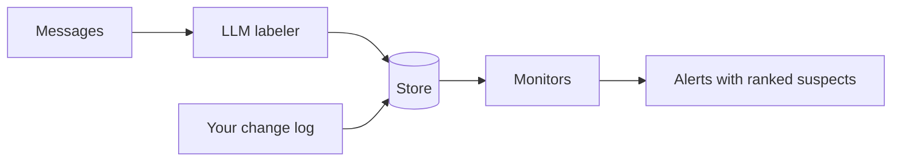

# open-sentinel

[](https://github.com/dholliday3/open-sentinel/actions/workflows/ci.yml)
[](LICENSE)

**Alerts from what your customers write.** open-sentinel reads every message people send you, alerts
when a problem starts showing up in them, and tells you which change most likely caused it.

A TypeScript library with no runtime dependencies. Works on support chat, customer texts and emails,
reviews, or an AI agent's transcripts.

> **Status:** pre-1.0, not on npm yet. Tested on synthetic data only. [Details](#project-status)

## Why open-sentinel

Some bugs never raise an error. A PDF renderer that adds tax twice throws nothing and slows nothing
down. The first sign is customers writing in to say their invoice is wrong, and nobody reads every
message.

- **Catch the bugs your error tracking can't see.** Ask plain-English questions about every message,
  like "Does the customer say something isn't working?", and watch the answers the way you watch
  error rates.
- **Know what caused it.** Each alert ranks the deploys and changes most likely behind it. When
  messages carry the app version, the right release came first in 40 of 40 trials, among six
  unrelated deploys a day.
- **Alerts you can trust.** Say how many false alerts a week you'll accept and it sets every
  threshold for you. In replay: 0.027 false pages a week, against a budget of 0.25.
- **One message can be enough.** A data leak or an account takeover pages on the first report.
- **Try a question before it goes live.** Ask it of stored history first. A week of messages (1,640)
  cost $0.025.
- **Fits your stack.** Alerts go to the console, files, webhooks or OpenTelemetry, and an MCP server
  lets an AI agent investigate.

### Why not just…

| Approach | What it misses |
|---|---|
| Keyword alerts | Can't read negation ("I'm not disputing the bill"), and miss any problem nobody wrote a keyword for |
| Alerts on message volume | Need lots of traffic: at 25 messages a week, a doubling of complaints was caught in 7% of weeks |
| Feedback dashboards | Show topics after the fact, in the vendor's categories, with no link to your deploys |
| Error and latency monitors | Only see what raises an error. Keep them; this is the net for everything else |

## Quickstart

```bash
npm install github:dholliday3/open-sentinel
```

Ask three questions of every support message, store the answers, and alert on them:

```ts
import {
  choice, consoleSink, createPipeline, createWatch, decisionLabeler, defineSchema,
  eventMonitor, HOUR, jsonlStore, shareMonitors, silenceMonitor, yesNo,
} from "open-sentinel";

const support = defineSchema({
  name: "support",
  questions: {
    area: choice("Which part of the product is the message about?", {
      login: "Signing in",
      billing: "Their plan or charges",
      other: "Anything else",
    }),
    is_bug_report: yesNo("Does the customer say something isn't working as it should?"),
    data_exposure: yesNo("Does the customer say they can see another business's information?"),
  },
});

const store = jsonlStore("./signals");
const labeler = decisionLabeler({
  model: "typesafe-ai/jev-1.14.0",
  apiKey: process.env.AI_GATEWAY_API_KEY!,
});
const pipeline = createPipeline({ schema: support, labeler, store });

await pipeline.ingest([
  {
    id: "msg-1",
    at: Date.now(),
    text: "I can see another company's customers in my account",
    unit: "account-42",
    tags: { version: "4.12.0" },
  },
]);

const watch = createWatch({
  schema: support,
  store,
  monitors: [
    ...shareMonitors({ signals: support.signals }),
    eventMonitor({ signal: "data_exposure" }),
    silenceMonitor({ windowMs: 3 * HOUR }),
  ],
  sinks: [consoleSink()],
});
await watch.tick();
```

Save it as `watch.ts` in a project with `"type": "module"`, set `AI_GATEWAY_API_KEY` to a
[Vercel AI Gateway](https://vercel.com/docs/ai-gateway) key, and run `node watch.ts`. When the model is at
least 90% sure a message reports a data leak, that one message pages:

```
2026-11-22T06:51:30.476Z fired page: event: data_exposure (event msg-1)
```

In production, call `watch.tick()` every hour from a timer or a cron job. Each tick can be a fresh
process, because the watch keeps its state in the store.

## How it works



1. **Write questions.** A schema is a set of typed questions: `yesNo`, `choice` and `score`.
2. **Label every message.** A model answers each question as a probability. Rewording a question starts
   a new version, so old and new answers are never mixed.
3. **Tag who and what.** Each message carries who wrote it and tags such as app version, plan or flag
   state.
4. **Watch the shares.** Monitors count customers, not messages, and compare against the same hours in
   earlier weeks.
5. **Alert with suspects.** Each alert lists the changes most likely behind it, and says when it isn't
   sure.

### Monitors

| Monitor | Alerts when |
|---|---|
| `shareMonitors` | More customers than usual raise something, over 3 hours, 24 hours or 3 days |
| `eventMonitor` | A single message is serious enough on its own |
| `exposureMonitor` | People a change reached complain more than everyone else, and more than they did before it |
| `volumeMonitor` | Twice as many messages arrive as a week earlier |
| `silenceMonitor` | Messages stop arriving where they used to |

Too little data is its own answer (`no_data`). It never alerts, and never counts as all clear.

## Real-world examples

Each one continues the quickstart and shows only what changes. Import what a snippet names from
`open-sentinel`. The snippets are type-checked in [`examples/recipes.ts`](examples/recipes.ts), and
[`examples/recipes.test.mjs`](examples/recipes.test.mjs) runs each one on synthetic messages.

<details>
<summary><strong>After a release, customers say their invoice total is wrong</strong></summary>

<br>

Nothing throws and nothing slows down, so error and latency monitors stay green. The first sign is
what customers write.

```ts
const billing = defineSchema({
  name: "billing",
  questions: { invoice_wrong: yesNo("Does the customer say an invoice total is wrong?") },
});
const release: Change = {
  id: "invoices-4.12.0", at: Date.parse("2026-11-20T15:00:00Z"), kind: "release",
  what: "invoices 4.12.0: new PDF renderer", scope: { version: "4.12.0" },
};
await store.recordChange(release);
const watch = createWatch({
  schema: billing,
  store,
  monitors: [
    ...shareMonitors({ signals: ["invoice_wrong"] }),
    exposureMonitor({ change: release, signal: "invoice_wrong" }),
  ],
  sinks: [consoleSink()],
});
```

Ingest each message with the `version` its customer is on. The 3-hour share pages and names the
release: `fired page: 3h share of invoice_wrong; likely invoices 4.12.0: new PDF renderer`. Read
the quoted messages in `notice.examples`, then roll back.

</details>

<details>
<summary><strong>One customer says they can see another company's data</strong></summary>

<br>

It is one message among hundreds, with no error and no spike. It has to page on its own.

The quickstart already watches `eventMonitor({ signal: "data_exposure" })`. This sink pages
PagerDuty with the question and the message:

```ts
const pagerDuty: Sink = {
  notify: async (notices) => {
    for (const { kind, alert, question, examples } of notices) {
      const quote = examples?.[0]?.text ?? "";
      const response = await fetch("https://events.pagerduty.com/v2/enqueue", {
        method: "POST",
        headers: { "content-type": "application/json" },
        body: JSON.stringify({
          routing_key: process.env.PAGERDUTY_ROUTING_KEY,
          event_action: kind === "fired" ? "trigger" : "resolve",
          dedup_key: alert.id,
          payload: { summary: `${question} "${quote}"`, source: "support", severity: "critical" },
        }),
      });
      if (!response.ok) {
        throw new Error(`PagerDuty answered ${response.status}`);
      }
    }
  },
};
```

Put it in the watch's `sinks`. The incident reads `Does the customer say they can see another
business's information? "I can see another company's customers in my account"`. The dedup key is
the alert's id, so a retried send, or a cron job that fired twice, opens one incident. To post the
whole notice to your own endpoint instead, use `webhookSink`.

</details>

<details>
<summary><strong>Android customers can't sign in after an app update</strong></summary>

<br>

Sign-in fails inside the app, so your servers see fewer requests, not errors. Only one platform is
affected, so the rise is diluted across everyone.

```ts
const android: Change = {
  id: "android-4.12.0", at: Date.parse("2026-11-20T15:00:00Z"), kind: "release",
  what: "Android 4.12.0: new sign-in library", scope: { version: "4.12.0" },
};
await store.recordChange(android);
const monitors = [
  ...shareMonitors({ signals: ["area=login"], where: { platform: "android" } }),
  exposureMonitor({ change: android, signal: "area=login" }),
];
```

Add these to the quickstart watch's `monitors`, and ingest each message with
`tags: { platform, version }`. `3h share of area=login {platform:android}` pages with Android 4.12.0
as the likely cause. Pause the rollout and check the new library.

</details>

<details>
<summary><strong>A pricing email brings a wave of billing questions that shouldn't page</strong></summary>

<br>

Here the rise is real and planned. A share monitor would page on it, and the wave would sit in next
week's baseline, hiding a real rise.

```ts
await store.recordChange({
  id: "price-email",
  at: Date.parse("2026-12-01T14:00:00Z"),
  kind: "campaign",
  what: "email to every customer about new prices",
  expect: { signals: ["area=billing", "*"], forMs: 2 * DAY },
});
```

The alert is still raised, marked `mutedBy: "price-email"` in what `tick` returns, but no notice
goes out, and the two days stay out of later baselines. If billing questions are still high after
two days, it pages then.

</details>

<details>
<summary><strong>Your AI support agent starts making promises after a prompt change</strong></summary>

<br>

The model answers fast and returns no errors. A promise it shouldn't make looks like any other
reply.

```ts
const transcripts = defineSchema({
  name: "agent",
  questions: {
    off_policy: yesNo("Did the assistant promise something the refund policy doesn't allow?"),
    wants_human: yesNo("Did the customer ask to talk to a person?"),
  },
});
const prompt: Change = {
  id: "prompt-v13", at: Date.parse("2026-11-20T15:00:00Z"), kind: "config",
  what: "support agent prompt v13", scope: { prompt: "v13" }, randomized: true,
};
await store.recordChange(prompt);
const watch = createWatch({
  schema: transcripts,
  store,
  monitors: [
    ...shareMonitors({ signals: transcripts.signals }),
    ...transcripts.signals.map((signal) => exposureMonitor({ change: prompt, signal })),
  ],
  sinks: [consoleSink()],
});
```

Ingest each exchange, the customer's message and the agent's reply, as one event tagged with the
prompt that answered: `tags: { prompt: "v13" }`. `randomized: true` says conversations were
assigned to v13 at random, so they can be compared with the rest as they are.
`off_policy among events exposed to prompt-v13` fires with the prompt as the likely cause. Read
the quoted replies, then roll the prompt back.

</details>

<details>
<summary><strong>Text replies from customers stop arriving</strong></summary>

<br>

When the SMS provider's webhook breaks, nothing errors: no requests means no failed requests. Share
monitors have nothing to count and say `no_data`.

```ts
const texts = defineSchema({
  name: "texts",
  questions: { wants_stop: yesNo("Does the customer ask to stop getting texts?") },
});
const watch = createWatch({
  schema: texts,
  store,
  monitors: [silenceMonitor({ windowMs: HOUR, periodMs: DAY, minBefore: 5 })],
  sinks: [consoleSink()],
});
```

It fires when an hour that had at least five replies the day before has none:
`fired page: no events`. Check that the provider still sends to your webhook, and that it gets a
200 back.

</details>

<details>
<summary><strong>A queue worker must not lose a message the model couldn't read</strong></summary>

<br>

Ack each message as you read it, and one the labeler failed on is gone. Ack when the source ends,
and a queue that never ends never acks.

```ts
await pipeline.run(queue.messages(), {
  onBatch: async ({ events, failed }) => {
    const unread = new Set(failed.map((failure) => failure.id));
    await queue.ack(events.filter((event) => !unread.has(event.id)));
    await queue.retryLater(events.filter((event) => unread.has(event.id)));
  },
});
```

`onBatch` runs after each batch is stored. A failed event isn't stored, so sending it again labels
it again. Keeping events in your own database? `storeContract` from `open-sentinel/testing` checks
your `Store` ([reference](docs/reference.md#writing-your-own)).

</details>

## Usage

These continue the quickstart. Also import `DAY`, `backtestQuestion`, `auditSample` and `fitGates`.

### Record what shipped

Log releases and campaigns so alerts can name a cause. `scope` says which messages a change reached.
`expect` marks a planned effect, such as a pricing email, so the spike it causes doesn't page anyone.

```ts
await store.recordChange({
  id: "release-4.12.0",
  at: Date.parse("2026-11-20T15:00:00Z"),
  kind: "release",
  what: "mobile 4.12.0: new sign-in library",
  scope: { version: "4.12.0" },
});
await store.recordChange({
  id: "price-email",
  at: Date.now(),
  kind: "campaign",
  what: "email about new prices",
  expect: { signals: ["area=billing", "*"], forMs: 2 * DAY },
});
```

### Try a new question on history

Stored messages keep their text, so you can ask a new question of the past before it pages anyone.

```ts
const tried = await backtestQuestion({
  events: await store.events({ schema: support.id, from: Date.now() - 7 * DAY }),
  key: "total_differs",
  question: yesNo(
    "Does the customer say an invoice their customer received shows a different total than the app?",
  ),
  labeler,
});
console.log(tried.cost, tried.signals[0]?.byBucket, tried.signals[0]?.surest);
```

In one live run on a week of synthetic history, this found 44 of a planted bug's 45 messages, flagged
nothing else, and cost $0.025.

### Check the labeler

Have a person check a sample, then let the answers set each threshold.

```ts
const events = await store.events({ schema: support.id });
const checked = auditSample(events, { signal: "data_exposure" })
  .map(({ event, weight }) => ({
    id: event.id,
    signal: "data_exposure",
    truth: reviewed(event),
    weight,
  }));
const { gates } = fitGates(events, checked, { objective: { precision: 0.9 } });
```

Pass `gates` to `createWatch`. `calibration`, `correctedRate` and `compareLabelers` tell you whether the
probabilities mean what they say, and what changes when you switch models.

## Integrations

Every part is a small interface. Swap one without touching the rest.

| Part | Included |
|---|---|
| Labeler | Decision models on the Vercel AI Gateway, any OpenAI-compatible chat model, or plain rules |
| Store | In memory, or files |
| Source | Any list or async stream of messages; JSONL files |
| Alerts | Console, file, webhook, OpenTelemetry logs |
| Investigation | Six tools for an AI agent, a written report on a group of alerts, an MCP server |

How to write your own: [docs/reference.md](docs/reference.md).

## Results on synthetic data

Two synthetic three-week support inboxes (4,820 and 4,990 messages), replayed with the defaults
([all results](docs/evaluation.md)):

| Check | Result |
|---|---|
| Planted incidents that alerted | 9 of 9, with no false alerts |
| Time to page on a sharp incident | under 2 hours |
| Time to page on a slow bug (about one message an hour) | 23 hours |
| Slow shifts reaching the daily digest | 3 to 6 days |
| False pages in incident-free weeks | 0.027 a week, against a budget of 0.25 |
| Right release ranked first, messages tagged with the version, six other deploys a day | 40 of 40 |
| Right deploy ranked first, no version on the messages (timing only) | 14 of 40, never marked confident |
| Planned marketing emails | muted, as declared |

## Good to know

- **Real data hasn't been tried yet.** Synthetic incidents describe themselves more clearly than real
  customers do.
- **Built for tens of thousands of messages a week, not millions.** Each tick rereads its lookback (17
  days by default), and the file store holds it in memory.
- **Attribution needs tags.** Helpdesks and SMS don't send the app version or flag state, so look them
  up when you ingest a message. Without them, suspects are ranked by timing alone.
- **Run one watch per store.** Two ticks in the same step share alert ids, so sinks can dedupe, but
  two processes ticking at once can still both save state.
- **A storm or a news story moves many customers at once.** That is a real shift, and it alerts.

More in [docs/limits.md](docs/limits.md) and [docs/guarantees.md](docs/guarantees.md).

## Project status

- **Built and tested:** questions and labelers, the pipeline, every monitor, alert delivery, change
  attribution, backtesting, labeler checks, the MCP server and the OpenTelemetry exporter.
- **Not built:** connectors to helpdesks or SMS providers, a database store, finding topics nobody wrote
  a question for, and alert routing (export to the tools that already do it).
- **May change:** any API, before 1.0.

<details>
<summary>Requirements: Node 22.18+, and npm 12 needs one flag for git installs</summary>

<br>

- npm builds the package from TypeScript as it installs. npm 12 refuses git dependencies unless you
  allow them: add `--allow-git=root`, or put `allow-git=root` in your project's `.npmrc`.
- Type declarations are included.
- A labeler needs a model: `decisionLabeler` calls a decision model through the Vercel AI Gateway,
  `chatLabeler` any OpenAI-compatible endpoint, and `ruleLabeler` plain functions with no model.

</details>

## Learn more

- [Reference: every part and how to write your own](docs/reference.md)
- [What happens when something fails](docs/guarantees.md)
- [The statistics](docs/statistics.md)
- [Full evaluation](docs/evaluation.md)
- [Known limits](docs/limits.md)

## Contributing and license

See [CONTRIBUTING.md](CONTRIBUTING.md). [MIT](LICENSE) licensed.
